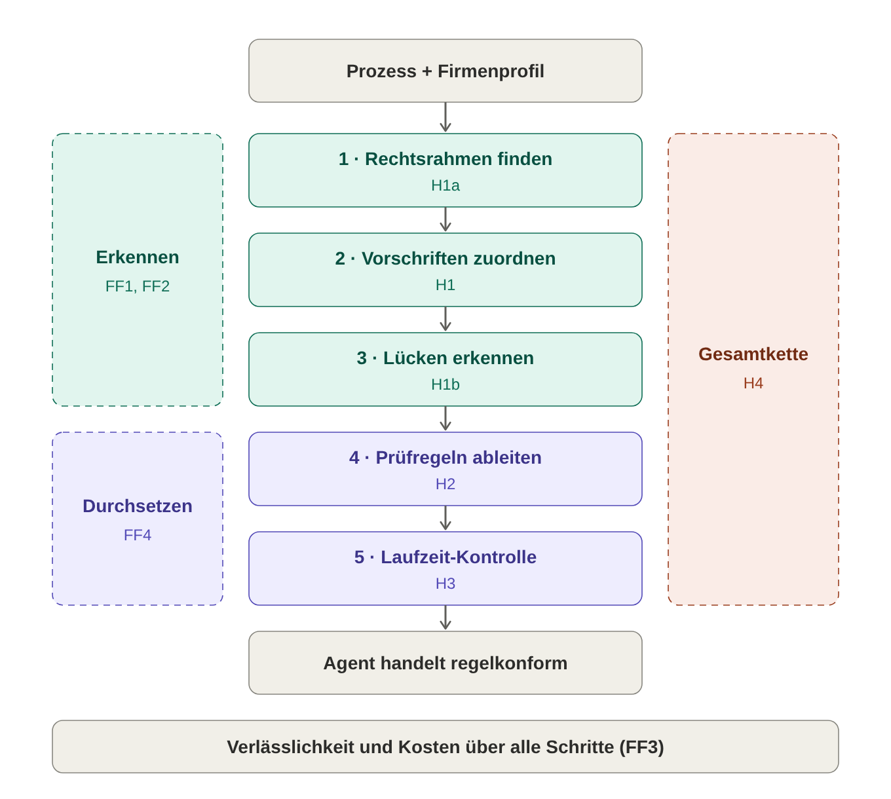

# Masterarbeit – Entwurf

Oct 22, 2026 · @Sebastian

Dieser Entwurf wächst von oben nach unten. Ebene 1 sind die Kernaussagen als Stichpunkte. **\[OFFEN\]** markiert Stellen, die noch nicht durchdacht sind, **\[v4\]** Zahlen, die nach Auftrag 004 nachgetragen werden. Abschnitte mit dem Vermerk „abgesegnet“ sind Satz für Satz freigegeben und werden nur noch mit Rücksprache geändert.

## Titel und zentrale Forschungsfrage (abgesegnet am 27.10.2026)

**Titel:** Regulatorische Anforderungen in KI-gestützten Geschäftsprozessen erkennen und zur Laufzeit durchsetzen

**Untertitel:** Ein LLM-Agent zur Zuordnung von Vorschriften, zur Erkennung von Compliance-Lücken und zur Runtime Verification am Beispiel eines Bewerbungsverfahrens an einer bayerischen Hochschule

**Zentrale Forschungsfrage:** Kann ein LLM-Agent für einen Geschäftsprozess die geltenden Vorschriften selbst recherchieren, den Arbeitsschritten zuordnen und fehlende Schritte erkennen – und lassen sich diese Vorschriften in Prüfregeln übersetzen, die das Verhalten eines KI-Agenten zur Laufzeit kontrollieren?

## Vorspann

**Kurzfassung** – **\[OFFEN\]** wird zuletzt geschrieben, auf Deutsch und Englisch, je ca. 200 Wörter.

**Glossar** (feste Begriffe, die in der ganzen Arbeit gleich verwendet werden)

| Begriff             | Bedeutung in dieser Arbeit                                                                        | Beispiel                                  |
|---------------------|---------------------------------------------------------------------------------------------------|-------------------------------------------|
| Regelwerk           | ein Gesetz, eine Verordnung oder ein Tarifvertrag                                                 | DSGVO, BayPVG, TV-L                       |
| Norm                | ein einzelner Artikel oder Paragraf                                                               | Art. 35 DSGVO                             |
| Fundstelle          | eine Norm mit Absatz                                                                              | Art. 26 Abs. 11 AI Act                    |
| Teilprozess / Task  | Abschnitt des Prozesses / einzelner Arbeitsschritt                                                | TP3 KI-Vorauswahl / T3.2 Ranking erzeugen |
| Lücke               | ein rechtlich gebotener Schritt, der im Prozess fehlt                                             | Datenschutz-Folgenabschätzung             |
| Soll-Liste          | der Goldstandard: welche Vorschrift zu welchem Task gehört und welche Lücken es gibt              | 48 Einträge                               |
| Konfiguration A / B | A: Agent bestimmt den Rechtsrahmen selbst; B: Agent bekommt den richtigen Rechtsrahmen vorgegeben | –                                         |
| Version             | ein Stand des Versuchs, bei dem eine Sache geändert wurde                                         | v1 bis v4                                 |
| Recall / Präzision  | Anteil der Soll-Einträge, die gefunden wurden / Anteil der Funde, die richtig sind                | –                                         |

## 1 Einleitung (5 Seiten)

*Leitfrage: Warum ist das Problem relevant, und was genau wird untersucht?*

**1.1 Motivation**

- Verwaltungen und Unternehmen wollen Prozesse mit KI automatisieren.

- Jeder Prozessschritt unterliegt Vorschriften aus mehreren Ebenen: EU, Bund, Land, Tarif.

- Heute prüfen Fachleute von Hand, welche Vorschrift wo gilt. Das ist teuer und fehleranfällig.

- **\[OFFEN\]** Beleg für den Aufwand oder die Regelungsdichte (Studie oder Zahl).

**1.2 Problemstellung**

- Zwei Fragen: Welche Vorschrift gilt an welchem Schritt? Und welcher vorgeschriebene Schritt fehlt ganz?

- Bisherige Ansätze (Sai et al. 2024) beantworten nur die erste Frage. Sie setzen einen vollständigen Prozess und eine vorgegebene Textsammlung voraus.

- Laufendes Beispiel: Eine Hochschule führt ein KI-Tool zur Vorauswahl von Bewerbungen ein.

**1.3 Forschungsfragen und Hypothesen (abgesegnet am 27.10.2026)**

Die zentrale Forschungsfrage wird entlang einer Kette von fünf Schritten untersucht (Abbildung 1.1). Jeder Schritt verarbeitet das Ergebnis des vorherigen und wird durch eine eigene Hypothese geprüft. Ob die Kette als Ganzes trägt, prüft Hypothese H4.

*Abbildung 1.1: Untersuchungskette der Arbeit. Die Schritte 1 bis 3 erkennen regulatorische Anforderungen, die Schritte 4 und 5 setzen sie zur Laufzeit durch.*

- **FF1:** Wie vollständig und wie genau bestimmt ein LLM-Agent mit eigener Recherche die für einen Geschäftsprozess geltenden Regelwerke und ordnet deren Vorschriften den einzelnen Arbeitsschritten zu?

  - **H1a:** Der Agent bestimmt die geltenden Regelwerke nahezu vollständig (Recall ≥ 0,9).

  - **H1:** Der Agent ordnet die geltenden Vorschriften den Arbeitsschritten mindestens so vollständig zu wie GPT-4 bei Sai et al. auf Task-Ebene (Recall ≥ 0,62).

- **FF2:** Erkennt der Agent rechtlich gebotene Schritte, die im Prozess fehlen?

  - **H1b:** Der Agent erkennt die Mehrheit der fehlenden Schritte, ohne vorhandene Schritte als fehlend zu melden.

- **FF3:** Wie beeinflussen die Gestaltung des Prompts und das Recherchewerkzeug die Vollständigkeit, die Genauigkeit, den Anteil erfundener Normen und die Kosten?

- **FF4:** Lassen sich die zugeordneten Vorschriften in maschinell prüfbare Regeln übersetzen, mit denen sich das Verhalten eines KI-Agenten zur Laufzeit kontrollieren lässt?

  - **H2:** Aus den zugeordneten Vorschriften lassen sich Prüfregeln erzeugen, die bei Referenzfällen dieselbe Entscheidung treffen wie eine fachliche Prüfung.

  - **H3:** Ein Laufzeitmonitor mit diesen Prüfregeln verhindert unzulässige Aktionen eines KI-Agenten, ohne zulässige Aktionen zu blockieren.

  - **H4:** Auch wenn die Ergebnisse des Agenten aus H1 und H1b unkorrigiert weitergegeben werden, verhindert die Laufzeit-Kontrolle die Mehrheit der unzulässigen Aktionen.

**1.4 Beitrag**

- ein Agent, der Vorschriften selbst recherchiert, statt aus einer vorgegebenen Sammlung auszuwählen

- Lückenerkennung als neue Aufgabe, mit einem eigenen Goldstandard

- ein Vergleich von Recherchewerkzeugen nach Qualität, Kosten und erfundenen Normen

**1.5 Aufbau der Arbeit** – ein Satz je Kapitel, wird zuletzt geschrieben.

## 2 Grundlagen (10 Seiten)

*Leitfrage: Was muss der Leser wissen, um den Rest zu verstehen?*

**2.1 Geschäftsprozesse**

- Ein Prozess besteht aus Teilprozessen, und die bestehen aus Tasks.

- In dieser Arbeit liegt der Prozess als strukturierte Liste vor und nicht als Grafik.

- **\[OFFEN\]** Wird BPMN als Notation erwähnt, und wenn ja, wie ausführlich?

**2.2 Regulatorische Compliance**

- Vorschriften kommen aus vier Ebenen: EU-Verordnungen gelten direkt, dazu Bundesrecht, Landesrecht und Tarifverträge.

- Beim öffentlichen Arbeitgeber in Bayern gilt anderes Recht als in der Privatwirtschaft: das BayDSG statt des BDSG und ein Personalrat statt eines Betriebsrats.

**2.3 Rechtsrahmen des Anwendungsfalls**

- Je Regelwerk zwei bis drei Sätze dazu, was es für eine Bewerbung regelt.

- Schwerpunkt AI Act: Ein KI-Tool zur Bewerberauswahl ist ein Hochrisiko-System (Anhang III Nr. 4). Die Hochschule hat als Betreiberin Pflichten (Art. 26) und muss als öffentliche Stelle eine Grundrechte-Folgenabschätzung machen (Art. 27).

- **\[OFFEN\]** Tiefe dieses Abschnitts: Er darf kein Rechtslehrbuch werden.

**2.4 Sprachmodelle und Agenten**

- Ein Agent ist ein Sprachmodell mit Werkzeugen, das in einer Schleife arbeitet: denken, Werkzeug aufrufen, Ergebnis lesen und wieder von vorn.

- Wichtige Bausteine: Werkzeugaufrufe (Function Calling), feste Antwortformate (Structured Outputs) und Reasoning.

- Risiko: Sprachmodelle erfinden manchmal Inhalte. Bei Rechtsnormen ist das besonders gefährlich.

**2.5 Bewertungsmaße**

- Recall: Wie viel vom Soll wurde gefunden? Präzision: Wie viel vom Gefundenen ist richtig?

- Bei Compliance zählt der Recall mehr: Eine übersehene Pflicht ist teurer als ein überflüssiger Hinweis.

- Weil das Modell nicht jedes Mal gleich antwortet, gibt es mehrere Läufe, ausgewertet als Mittelwert ± Standardabweichung.

## 3 Verwandte Arbeiten (6 Seiten)

*Leitfrage: Was gibt es schon, und welche Lücke schließt diese Arbeit?*

**3.1 Sai et al. 2024**

- Aufgabe: Welche Absätze aus Vorschriften sind für einen Geschäftsprozess relevant?

- Daten: zwei Anwendungsfälle, Reiseversicherung und Kundenidentifikation bei Banken (KYC)

- Verglichen wurden GPT-4, Embedding-Verfahren, Crowd-Arbeiter und Experten.

- Ergebnis: GPT-4 erreicht auf Prozessebene einen Recall von bis zu 1,0, auf Task-Ebene 0,62–0,77.

- Grenzen: Der Prozess gilt als vollständig, die Textsammlung ist vorgegeben, und Querverweise werden nicht verfolgt.

**3.2 Rechtsinformationssuche mit Sprachmodellen**

- **\[OFFEN\]** Literatur suchen: Legal Information Retrieval, retrieval-gestützte Generierung im Recht, erfundene Zitate in juristischen Antworten

**3.3 Runtime Verification von Agenten (C-Trace)**

- **\[OFFEN\]** Inhalt nachtragen. Umfang hängt von der Entscheidung zu H2/H3 ab.

**3.4 Forschungslücke**

|                   | Sai et al. 2024          | Diese Arbeit                                      |
|-------------------|--------------------------|---------------------------------------------------|
| Prozess           | vollständig angenommen   | bewusst unvollständig                             |
| Vorschriften      | vorgegebene Textsammlung | Agent recherchiert selbst                         |
| Fehlende Schritte | nicht betrachtet         | eigene Forschungsfrage (FF2)                      |
| Erfundene Normen  | nicht geprüft            | automatisch geprüft                               |
| Rechtsraum        | Australien               | Deutschland und EU, öffentlicher Dienst in Bayern |

## 4 Methodik (10 Seiten)

*Leitfrage: Wie ist der Versuch aufgebaut, und wie wird gemessen?*

**4.1 Forschungsdesign**

- Experimentell und iterativ: Jede Version ändert eine Sache, und alle Versionen werden gegen dieselbe Soll-Liste ausgewertet.

| Version | Was sich ändert                                                                                                                    | Recherche        |
|---------|------------------------------------------------------------------------------------------------------------------------------------|------------------|
| v1      | Ausgangsstand                                                                                                                      | OpenAI-Websuche  |
| v2      | Prompt für Stufe 2 strenger (eine Norm je Fund, Lücke nur ohne passenden Task); Prozess an zwei Tasks präzisiert; Stelle befristet | OpenAI-Websuche  |
| v3      | eigenes Recherchewerkzeug statt Websuche                                                                                           | eigene Werkzeuge |
| v4      | Werkzeug verbessert (Abkürzungen, Kennung, höhere Limits)                                                                          | eigene Werkzeuge |

**4.2 Anwendungsfall**

- Hochschule München als öffentlicher Arbeitgeber in Bayern, befristete Stelle für eine wissenschaftliche Mitarbeiterin bzw. einen wissenschaftlichen Mitarbeiter nach TV-L

- Prozess mit 6 Teilprozessen und 19 Tasks, von der Ausschreibung bis zur Löschung der Daten

- Bewusst entfernte Schritte, etwa die Information der Bewerber über den KI-Einsatz

- Warum dieser Fall: viel Regulierung auf allen Ebenen, Hochrisiko nach AI Act, und Fachleute an der HM erreichbar

**4.3 Goldstandard (Soll-Liste)**

- 48 Einträge: 23 Zuordnungen, 9 Lücken und 16 neutrale Einträge, die relevant sind, aber nicht bewertet werden

- Entstehung offen beschrieben: Entwurf durch den Autor, nach dem ersten Lauf an zwei Stellen korrigiert, nachdem der Gesetzestext geprüft war (Art. 78 BayPVG, Art. 17 BayGlG)

- **\[OFFEN\]** fachliche Prüfung durch eine Expertin oder einen Experten

**4.4 Aufbau des Agenten**

- Stufe 1: Firmenprofil und Prozess führen zum Rechtsrahmen, also der Liste der geltenden Regelwerke.

- Stufe 2: Je Task und mit dem Rechtsrahmen entstehen konkrete Fundstellen mit Begründung.

- Lückenkandidaten sind Funde, die einen fehlenden Schritt melden.

- **\[OFFEN\]** Abbildung des Ablaufs

**4.5 Versuchsplan**

- Konfiguration A bestimmt den Rechtsrahmen selbst. B bekommt den richtigen Rechtsrahmen und zeigt damit, wo die Fehler entstehen.

- Je Version und Konfiguration gibt es 5 Läufe.

**4.6 Auswertungsregeln**

- Jeder Fund wird bewertet als korrekt, neutral, falscher Absatz, falscher Task oder nicht in der Soll-Liste.

- Jede Lückenmeldung wird bewertet als echte Lücke, als Schritt, der in Wahrheit vorhanden ist, oder als Meldung ohne Soll-Eintrag.

- Existenzprüfung: Jede genannte Norm wird in der Quelle nachgeschlagen. Gibt es sie nicht, gilt sie als erfunden.

**4.7 Reproduzierbarkeit und Kosten**

- Je Lauf protokolliert: Modellversion, Prüfsumme des Prompts, alle Quellen mit Abrufdatum und jeder API-Aufruf mit Kosten

- Alles liegt im Repo: Code, Eingaben, Rohantworten, Auswertung.

## 5 Implementierung (6 Seiten)

*Leitfrage: Wie wurde der Agent technisch umgesetzt?*

**5.1 Architektur**

- Python 3.12, OpenAI Responses API, Modell GPT-6 Luna, Ausführung im Docker-Container

- Datenfluss in Ordnern: input → runs (Rohantworten je Lauf) → results (Auswertung)

- **\[OFFEN\]** Architekturbild

**5.2 Recherchewerkzeuge**

- Vier Funktionen: Regelwerk suchen, Inhaltsverzeichnis laden, Norm laden, Volltext durchsuchen

- Quellen: gesetze-im-internet.de, gesetze-bayern.de, EUR-Lex (abgerufen über Cellar, den Datendienst desselben Herausgebers) und tdl-online.de

- Jede Seite wird einmal geladen und zwischengespeichert, höchstens eine Anfrage pro Sekunde.

- Grenzen: Die Suche bei gesetze-bayern.de findet keine reinen Abkürzungen, und EUR-Lex blockiert automatische Abrufe.

**5.3 Protokoll und Kostenkontrolle**

- Jeder API-Aufruf wird mit Tokens und Kosten protokolliert.

- Vor jedem Aufruf prüft das Programm das Budget und bricht ab, wenn es überschritten würde.

**5.4 Vorgehen bei der Entwicklung**

- Planung und Umsetzung liefen über nummerierte Aufträge im Repo. Jede Änderung ist dadurch nachvollziehbar.

- **\[OFFEN\]** Einsatz von KI-Assistenten offenlegen (Planung, Programmierung); dazu die Vorgaben der HM zur KI-Nutzung in Abschlussarbeiten prüfen.

## 6 Ergebnisse (12 Seiten)

*Leitfrage: Was kam heraus, getrennt nach Forschungsfrage?*

Stand der Zahlen: 22.10.2026, Konfiguration A, Mittelwert über die Läufe (h1/results/kennzahlen.csv). Die Spalte v4 folgt nach Auftrag 004.

| Kennzahl                        | v1 (n=1) | v2 (n=5) | v3 (n=5) | v4         |
|---------------------------------|----------|----------|----------|------------|
| Stufe 1: Recall Regelwerke      | 100 %    | 98 %     | 87 %     | **\[v4\]** |
| Stufe 2: Recall Zuordnung       | 70 %     | 98 %     | 66 %     | **\[v4\]** |
| Stufe 2: Präzision              | 58 %     | 54 %     | 60 %     | **\[v4\]** |
| Lücken-Recall (streng)          | 100 %    | 80 %     | 16 %     | **\[v4\]** |
| Falsche Lückenmeldungen je Lauf | 14       | 4,2      | 0,8      | **\[v4\]** |
| Erfundene Normen                | 0        | 0        | 0        | **\[v4\]** |
| Kosten je Lauf                  | 1,09 USD | 1,09 USD | 0,06 USD | **\[v4\]** |

**6.1 FF1, Stufe 1: Rechtsrahmen** – Mit Websuche werden fast alle Regelwerke gefunden. In v3 fehlt das Nachweisgesetz in jedem Lauf.

**6.2 FF1, Stufe 2: Zuordnung** – Mit Websuche ist die Zuordnung nahezu vollständig, aber breit: Das Modell ordnet Normen eher zu vielen Tasks zu.

**6.3 FF2: Lückenerkennung** – Datenschutz-Folgenabschätzung, Grundrechte-Folgenabschätzung und Schwerbehindertenvertretung werden zuverlässig erkannt. Organisatorische Lücken wie die KI-Schulung (Art. 4 AI Act) gehen leicht verloren.

**6.4 FF3: Prompt (v1 → v2)** – Der strengere Prompt senkt die falschen Lückenmeldungen von 14 auf 4. Dafür sinkt der Lücken-Recall von 100 % auf 80 %. Das ist ein Zielkonflikt.

**6.5 FF3: Recherchewerkzeug (v2 → v3 → v4)** – Das eigene Werkzeug senkt die Kosten um 95 %, verschlechtert aber zunächst die Qualität. Ursache sind Werkzeuggrenzen, nicht das Modell. **\[v4\]** Ob die Verbesserungen das ausgleichen.

**6.6 Wo entstehen die Fehler? (A gegen B)** – In v3 erreichen A und B fast den gleichen Recall (66 % gegen 67 %). Die Fehler entstehen also in Stufe 2, nicht bei der Bestimmung des Rechtsrahmens.

**6.7 Erfundene Normen und Streuung** – Keine erfundene Norm in 2.154 Funden, geprüft auf Ebene Artikel bzw. Paragraf. **\[v4\]** Prüfung bis auf den Absatz.

**\[OFFEN\]** Abbildungen: Kennzahlen je Version als Diagramm, Lücken je Soll-Eintrag als Tabelle.

## 7 Diskussion (8 Seiten)

*Leitfrage: Was bedeuten die Ergebnisse, und wie belastbar sind sie?*

**7.1 Antworten auf die Hypothesen**

- H1 (Zuordnung): vorläufig bestätigt, wenn das Recherchewerkzeug gut genug ist. **\[v4\]**

- H1b (Lücken): teilweise bestätigt. Klar benannte Pflichten werden erkannt, organisatorische Voraussetzungen seltener.

**7.2 Der Agent korrigiert den Goldstandard**

- In zwei Fällen hatte das Modell recht und die Soll-Liste nicht: Wissenschaftliches Personal ist von der Mitbestimmung bei der Einstellung ausgenommen (Art. 78 BayPVG), und die Gleichstellungsbeauftragte nimmt nur auf Antrag teil (Art. 17 BayGlG).

- Folgerung: Auch ein Goldstandard ist fehleranfällig. Der Agent eignet sich als zweite Prüfinstanz, nicht als Ersatz für Fachleute.

**7.3 Vergleich mit Sai et al.**

- Der Recall auf Task-Ebene liegt hier höher. Die Zahlen sind aber nur eingeschränkt vergleichbar: anderes Recht, andere Aufgabe und eigene Recherche statt einer vorgegebenen Sammlung.

**7.4 Grenzen**

- nur ein Anwendungsfall

- Soll-Liste selbst erstellt und nach dem ersten Lauf angepasst; die Werte sind dadurch eher zu günstig

- 5 Läufe je Konfiguration, ein Modell, ein Stichtag der Rechtslage

- die Kategorie „neutral“ beeinflusst die Präzision und muss offen benannt werden

- **\[OFFEN\]** Ergebnis der fachlichen Prüfung der Soll-Liste

**7.5 Bedeutung für die Praxis**

- Ein solcher Agent kann Fachleuten vor der Einführung eines KI-Tools eine Prüfliste vorschlagen, mit Fundstelle und Begründung.

- Weil die Kosten niedrig sind und alles protokolliert wird, lässt er sich auch in der Verwaltung einsetzen. **\[OFFEN\]** Datenschutz beim Einsatz externer Modelle

## 8 Fazit und Ausblick (3 Seiten)

*Leitfrage: Was sind die Antworten auf FF1–FF4, und was folgt daraus?*

**8.1 Fazit** – je Forschungsfrage zwei Sätze, die direkt auf die Ergebnisse verweisen. **\[OFFEN\]** wird nach Kapitel 6 und 7 geschrieben.

**8.2 Ausblick**

- H2/H3: gefundene Vorschriften in prüfbare Regeln übersetzen und zur Laufzeit durchsetzen (Brücke zu C-Trace)

- weitere Anwendungsfälle, etwa Brandmeldetechnik mit DIN-/VDE-Normen, die urheberrechtlich geschützt und nicht frei verfügbar sind

- lokales Modell statt Cloud: Datenschutz und Kosten

- Querverweise zwischen Normen gezielt verfolgen

**Anhang** – Prompts aller Versionen, Soll-Liste, Prozess und Firmenprofil, Kennzahlentabelle, Link zum Repo
